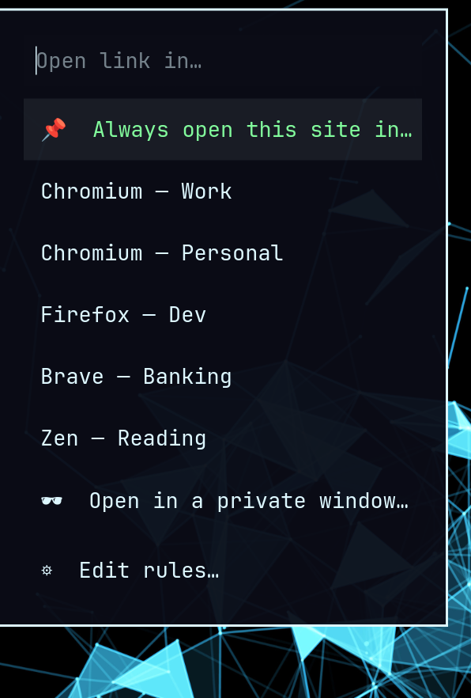
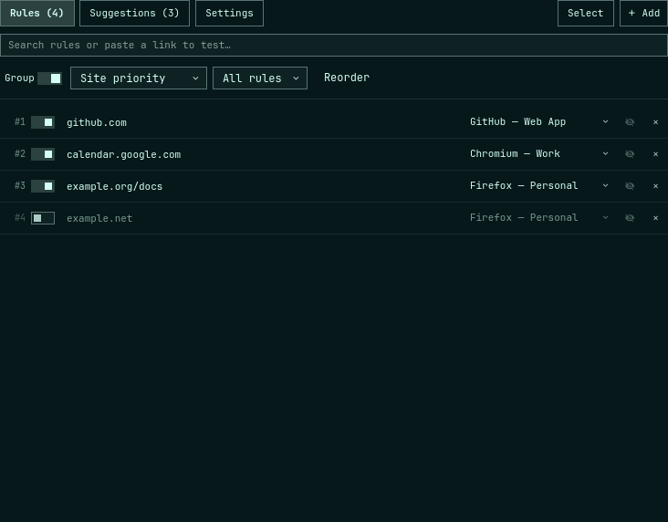
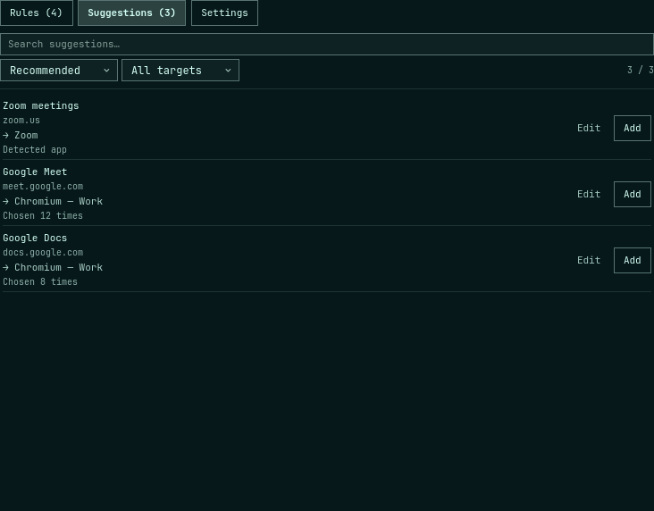
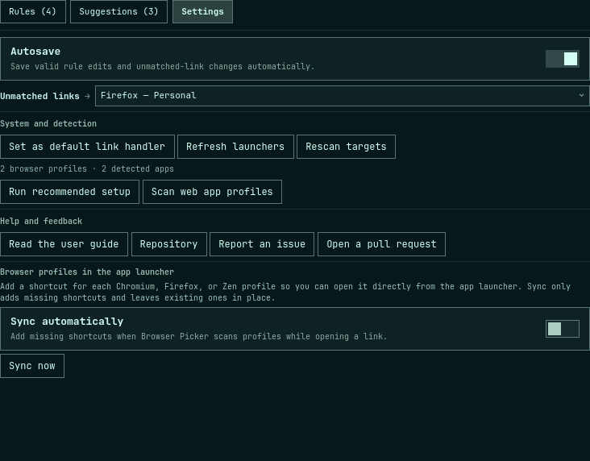
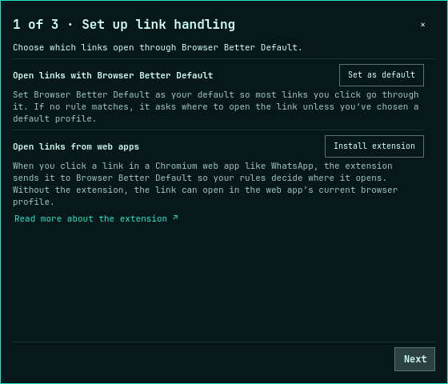

# browser-better-default

A Linux link picker that lets you choose a **browser profile, desktop app, or installed
web app**. Set smart defaults to open recurring links directly in your preferred app
or profile.

## Quick install

On Omarchy Quattro, run this from your regular user account:

```sh
omarchy plugin add https://github.com/dataforxyz/browser-better-default.git --enable &&
  omarchy-shell shell summon browser-better-default '{"setup":true}'
```

This opens **Browser Better Default** and starts the guide for setting up
link handling, the optional extension, and app rules. To reopen the window later,
use the bar’s tray or run:

```sh
omarchy-shell shell summon browser-better-default '{}'
```

[Manual install and update instructions](#install)

**Open T3 Code thread links in the desktop app.** Click an `app.t3.codes` share link
and choose **T3 Code** to jump to the exact thread, including delegated threads on
linked environments. The picker also offers installed apps for supported links like
Spotify tracks and Zoom meetings, plus matching Omarchy and Chromium web apps.

Built for [Omarchy Quattro](https://omarchy.org) / Hyprland with its native menu, and supports
[Walker](https://github.com/abenz1267/walker) and other `dmenu`-style menus on other desktops.


<p align="center">
  
  &nbsp;&nbsp;
  
</p>

<p align="center"><em>Choose where a link opens, then save a rule for links you want to open the same way next time.</em></p>

| [Suggestions](#using-the-rules-editor) | [Settings](#recommended-setup) |
| --- | --- |
|  |  |

## Why

If you keep several browsers and many profiles (work, personal, clients, AI accounts…),
a single "default browser" is the wrong model. browser-picker lets you decide *per link*,
and remembers the decisions you want to make permanent.

## Features

- **Picker on every link** — choose a browser + profile (or matching local desktop/web app) from a menu (Omarchy Quattro’s native menu, Walker, or your `BROWSER_PICKER_MENU`); the prompt shows the target URL (without query/fragment noise).
- **Browser profiles in the app launcher** — in **Settings**, choose **Sync now** to add missing Chromium, Firefox, and Zen shortcuts. Turn on **Sync automatically** to add them during the picker's link-opening profile scan. Existing shortcuts are kept.
- **Local apps & web apps** — automatically offers installed desktop apps when a web URL maps to them (including **T3 Code** `app.t3.codes` thread/prompt links, Spotify, Zoom, Slack, Telegram, Discord, Linear, Notion, Figma, Microsoft Teams, Steam, Signal, Matrix) plus installed Omarchy / Chromium `--app=` web apps and custom entries in `apps.conf`. Matching apps appear only for relevant URLs, work with smart-default rules and habit learning, and never clutter unrelated links.
- **Smart defaults** — rules like `github.com/myorg/myrepo → Chromium (Work)` open
  directly, no menu. Plain text matches on **path/host boundaries** (covers a URL *and its
  child paths*, but `…/repo` won't match `…/repo-staging`); `*`/`?` = glob; `regex:` prefix
  = full regex. First match wins.
- **In-flow rule creation** — pick *📌 Create a rule for links like this…* from the menu and the Omarchy
  editor opens **pre-filled** from the current URL; trim the scope, pick a profile, Save.
- **Learns your habits** — repeat a profile for a site and the picker grows explicit
  `⭐ Always open scope in profile` shortcuts below one-time choices (see below). Fully **local & offline**.
- **Private/incognito** — every profile also appears as a *🕶 Private* twin in the menu
  (regular profiles first, private ones below), so one pick opens it in a private window
  (`--incognito` / `--private-window` chosen per browser family).
- **Default for unmatched links** — optionally route everything that matches no rule to a
  chosen profile (a catch-all), instead of always showing the menu.
- **Omarchy rules editor** — review suggestions from detected apps and repeated
  picks. Sort by use or recency, filter by target type, and add the rules you want.
  For example, a detected Zoom client can
  handle meeting links across regional Zoom hosts. Edit, enable, or reorder rules,
  choose a fallback for unmatched links, and find rules that reference missing profiles.
  Completed rule edits autosave by default. Turn **Autosave** off in **Settings**
  to save changes manually. New browser profiles are auto-added when the picker
  opens or when you rescan targets.
- **App setup** — choose detected apps such as Zoom and installed web apps to add
  their link rules together. Reopen it from **Settings → Run recommended setup**.
- **Routes** `http`, `https`, and `mailto`.

## Install

### Omarchy Quattro (recommended)

```sh
omarchy plugin add https://github.com/dataforxyz/browser-better-default.git --enable &&
  omarchy-shell shell summon browser-better-default '{"setup":true}'
```

In the guide, use **Set as default** to register it for web and email links. If you’ve already
dismissed the prompt, choose **Settings → Run recommended setup**. If the tray
is hidden, open the window from a terminal:

```sh
omarchy-shell shell summon browser-better-default '{}'
```

To move an existing install into the plugin checkout, use **Refresh launchers**
under **Settings**. It repoints the commands to the plugin checkout, preserving
your rules, profiles, and current link defaults.

### Update on Omarchy

```sh
omarchy plugin update browser-better-default
```

The installed commands follow the plugin checkout, so picker code updates apply
right away. If a release changes desktop entries or adds a command, open the
editor, choose **Settings**, and click **Refresh launchers** to apply those changes.

If you use the optional [Chromium web-app bridge](docs/BRIDGE.md), set it up from
`~/.config/omarchy/plugins/browser-better-default` so it follows that checkout
too. When migrating an existing bridge, replace its old extension path in the
browser flags (or in the unpacked extension settings) with the plugin checkout's
`extension/` path, then restart the browser.

### Manual install

To develop from your own checkout, you can install the link handler manually.
The rules editor opens through the enabled Omarchy plugin.

```sh
git clone https://github.com/dataforxyz/browser-better-default
cd browser-better-default
./install.sh
```

On a first interactive Wayland install, the script opens the guide if the
Omarchy plugin is enabled. Updates and launcher refreshes leave the GUI closed.

The `main` branch targets current Omarchy Quattro. The previous pre-Quattro version is
preserved as [`archive/pre-quattro-20261115`](https://github.com/dataforxyz/browser-better-default/tree/archive/pre-quattro-20261115).
To check out that historical version instead, run `git switch --detach archive/pre-quattro-20261115`
after cloning. It is an archive, not a maintained compatibility branch.

`install.sh` symlinks the executables into `~/.local/bin`, installs the `.desktop`
launchers, seeds `~/.config/browser-picker/` from the examples (without overwriting an
existing config), and registers the picker as the default web/link handler for `http`,
`https`, and `mailto`.

> Ensure `~/.local/bin` is on your `PATH`. Because the install uses symlinks, keep the clone
> around (or reinstall from the new location if you move it).

To update a manual install, run `git pull --ff-only` and then
`./install.sh --refresh` from the checkout.

### What the installer changes

Core install only touches user-level files:

- `~/.local/bin/browser-picker*` symlinks (replaces same-name files/symlinks)
- `~/.local/share/applications/browser-picker*.desktop` (regenerated on each install)
- `~/.config/browser-picker/{browsers.conf,rules.conf,apps.conf}` if missing
- XDG default handlers for `http`, `https`, and `mailto`

It does **not** require `sudo` and it does **not** install the Chromium web-app bridge by
default. Restore automation that wants the bridge can run `./install.sh --with-bridge` or
set `BROWSER_PICKER_INSTALL_BRIDGE=1`. See
[docs/BRIDGE.md](docs/BRIDGE.md) before opting into that extra step.

### Requirements

- On Omarchy Quattro, the included shell provides `omarchy-menu-select`; the installer
  adds a small adapter and gives it a 720px width and 600px maximum height by default.
  Walker is the fallback on other desktops. Other menus can be wired with
  `BROWSER_PICKER_MENU`, for example:

  ```sh
  export BROWSER_PICKER_MENU='wofi --dmenu --prompt "$BROWSER_PICKER_PROMPT"'
  ```

- Python 3 for app detection, recommendations, and rules storage.
- `xdg-utils`, `util-linux` (`setsid`).

## Using the rules editor

Rules decide which browser profile or app opens a link. Enter a domain such as
`example.com` in the pattern field and choose where matching links should open.
Browser Picker tries enabled rules in priority order, starting at #1. Sorting,
filtering, and grouping change how you see the rules. Use **Reorder** to change
which rule is tried first. When two enabled rules use the same pattern, the
**Conflicts** filter shows the later rules. Paste a full URL into Rules search
to check which rules match and which destination would open.

**Suggestions** offers rules for detected apps and destinations you've chosen
before. Review the pattern and destination before adding a suggestion. With
**Autosave** off, click **Save changes** to apply rule edits and your
**Unmatched links** choice.

## Recommended setup

Open **Settings → Run recommended setup** any time:



1. **Set up link handling** makes Browser Picker the system handler for web
   and email links. Install the [web app bridge](docs/BRIDGE.md) here if you
   want Browser Better Default to open links clicked inside Chromium web apps.
2. **Recommended app rules** lets you choose which detected apps should open
   matching links, such as Zoom meeting links.
3. **Optional extras** lets you pin web apps to a profile or create profile
   shortcuts.

## Configuration

Three files in `~/.config/browser-picker/`:

- **`browsers.conf`** — `Label|||command` per line. The picker auto-adds newly discovered profiles; you can also use *Rescan targets* in the editor.
- **`rules.conf`** — `enabled|||pattern|||label[|||private]` per line (optional 4th field
  `1` opens matching links in a private window). Managed by the editor; `label` can name either a browser profile or a local app.
- **`apps.conf`** — optional `Label|||pattern|||command` overrides for custom local apps, `uri:` scheme rewrites, or disabling an auto-discovered app.

All three are read fresh on every link click — no daemon, no restart.

See **[docs/CONFIGURATION.md](docs/CONFIGURATION.md)** for the full reference: pattern
syntax (plain / glob / `regex:` / catch-all), the editor, profile detection, menu selection,
uninstall/revert steps, and troubleshooting.

## How it works

`browser-picker` is registered as the handler for web/mailto links. On each link it checks
`rules.conf` for the first enabled match and launches that profile directly; otherwise it
shows the menu. Profiles are launched detached via `setsid`.

Profile detection reads Chromium-family `Local State` (`profile.info_cache`) and
Firefox-family `profiles.ini`. It only adds new entries; it does not remove or rename entries
you edited by hand. Set `BROWSER_PICKER_AUTO_RESCAN=0` if you do not want the picker to touch
`browsers.conf` automatically.

## Optional Chromium / omarchy web-app bridge

Chromium `--app=` windows (including omarchy web apps) can open clicked links internally,
bypassing the system default browser. If you want those links to go through browser-picker
as well, choose **Install extension** in the Set up link handling step of
**Settings → Run recommended setup**, or opt into the bridge from the command line:

```sh
./install.sh --with-bridge
```

You can also run `extension/install-bridge.sh` directly after a core install. Read
**[docs/BRIDGE.md](docs/BRIDGE.md)** first. The bridge installs a native-messaging host
and adds the extension to user-level browser flags files. The extension uses Chromium's
`webNavigation` and `nativeMessaging` permissions to pass eligible links to the local picker.

## Privacy and safety

- No network calls, telemetry, API keys, or remote services.
- Your profile list and rules live under `~/.config/browser-picker/`.
- The local recommender stores up to 1000 recently picked `http(s)` URLs in
  `~/.config/browser-picker/history.json`. Delete that file any time to reset learning.
- Older versions of the optional bridge logged app-window URLs to
  `~/.cache/browser-picker/bridge.log`. You can delete that file.
- `browsers.conf` commands are local shell command snippets. Do not paste browser-picker
  config from people you do not trust.

## Learns your habits

`browser-picker` quietly notes which profile you manually pick for which link (including
private-window picks, tracked separately; never links already auto-routed by a rule). Once
you've opened a similar place in the same profile a couple of times, the **next** time you
open a matching link the picker shows one-click default shortcuts after the one-time choices, with the rule
scope front-loaded so it is clear what will be saved:

```
⭐  Always open github.com/myorg in Chromium — Work
⭐  Always open github.com/myorg/myrepo in Chromium — Work
```

Pick it and the link opens in that profile **and** the rule is written, so it auto-routes from
then on. No second popup, no extra step — pick a normal profile instead and it just opens (and
keeps learning). It **generalizes across URLs** rather than memorizing one address, suggesting
the broadest pattern owned by a *dominant* profile (one stray pick with another profile won't
veto an obvious habit; a genuine 50/50 tie stays quiet):

| What you opened (same profile)                          | Shortcut creates  |
| ------------------------------------------------------- | ----------------- |
| the same repo, repeatedly                               | `github.com/org/repo` |
| a few repos under one org                               | `github.com/org`  |
| a few orgs on a host you only use with one profile      | `github.com`      |

Picks made in a **private/incognito** window are learned separately: repeat one and the
shortcut offers a *private* default (e.g. *⭐ Always open example.com in Brave 🕶 Private*), which writes a rule
that always opens that scope in a private window. Normal and private habits never mix.

The **menu itself is smart-ordered**. The destination you're most likely to want
for this link comes first. One-time destinations and private windows come
before the **Always open** choices that save a rule. **Create a rule for links
like this** and **Edit rules** sit at the end. Type to filter the list.

This is a **local recommender** (`browser-picker-recommend`) — no network, no API keys, no
LLM; your URLs never leave the machine. History lives in
`~/.config/browser-picker/history.json`. The shortcut appears on the **1st repeat** (the 2nd
matching open) by default; raise it with `threshold=N` in
`~/.config/browser-picker/settings.conf` (or the `BROWSER_PICKER_SUGGEST_THRESHOLD` env var),
minimum `2`.

## Notes / limitations

- Firefox & Zen open one profile at a time — opening a link in a profile while a *different*
  profile of the same browser is running may defer to the running instance (a browser
  limitation, not this tool). Chromium-family handle concurrent profiles fine.
- *Rescan* only **adds** newly found profiles; it won't delete entries you've removed by
  hand (so custom entries like a bare `Brave` survive).

## Development

The test suite requires Python 3 and Node.js.

```sh
bash tests/run.sh   # shellcheck + bash syntax + py_compile + unit tests
```

- `tests/test_matching.sh` — `matches()` (boundary/glob/regex) and `private_flag()`.
- `tests/test_picker_apps.sh` — end-to-end picker + rules + habit learning with local apps & web apps.
- `tests/test_apps.py` — native desktop app URL converters, XDG discovery, web apps, and `apps.conf`.
- `tests/test_rules.py` — `default_pattern`, `normcmd`, `model_items`, `load_rules`, `load_labels`.
- `tests/test_recommend.py` — local recommender pattern, ranking, private-mode, and rule-writing logic.
- `tests/test_bridge.js` and `tests/test_bridge_host.py` — extension routing and native messaging.

CI runs the same suite on every push/PR (see `.github/workflows/ci.yml`).

## License

MIT — see [LICENSE](LICENSE).
